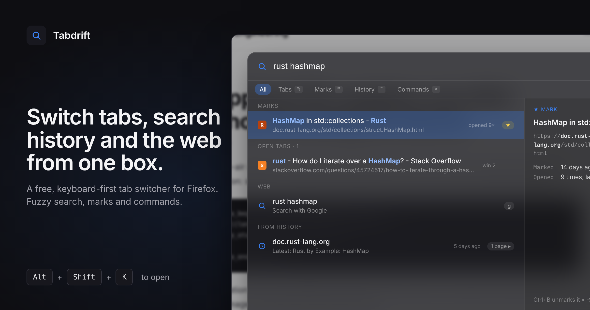

# Tabdrift



[](https://addons.mozilla.org/firefox/addon/tabdrift/)

A fast, keyboard-first tab switcher for Firefox. Press a shortcut, type a
few letters, jump straight to the tab you meant.

## What it does

Tabdrift opens a floating search overlay over whatever page you're on.
It filters your open tabs by title or URL as you type, across every
window, and switches to the one you pick with the arrow keys and enter.
Matching works like fzf and Telescope: letters can be spread out
(`rbook` finds `doc.rust-lang.org/book`), words can come in any order, and
the matched letters are highlighted.

It knows about site names, subdomains included. `search google`,
`google search` and `search.google` all find `search.google.com`, `gcal`
finds `calendar.google.com`, `gh` finds GitHub, and typing a whole part of
an address (`calendar`, `mail google`) ranks that site above pages that only
mention the words. Scattered matches that hit random letters in the middle
of words ("rust" in "Pull requests") are left out.

### Search syntax

| Type        | Finds                                               |
| ----------- | --------------------------------------------------- |
| `rust book` | both words, in any order, in the title or address   |
| `'exact`    | that exact text                                     |
| `^git`      | titles or addresses that start with it              |
| `.pdf$`     | titles or addresses that end with it                |
| `!jira`     | leaves out anything containing it                   |
| `Rust`      | a capital letter makes that word match case exactly |

### Scopes

Narrow the search to one kind of thing, like Telescope's pickers. The keys
are the ones Firefox's own address bar uses: type the symbol and a space at
the start.

| Key | Scope    | Before you type                     |
| --- | -------- | ----------------------------------- |
| `%` | Tabs     | all your tabs, most recent first    |
| `*` | Marks    | your marks, most used first         |
| `^` | History  | the sites you visited most recently |
| `>` | Commands | everything you can do (see below)   |

**Tab** and **Shift+Tab** cycle through the scopes, and **Backspace** in an
empty box goes back to searching everything. The scope bar under the search
box is clickable too.

### Rearrange tabs

The **Arrange** scope (between Tabs and Marks, no prefix key) lists your tabs
in tab bar order, one section per window, starting on the tab you're on.

- **Alt+Up / Alt+Down** (**Option** on a Mac) moves the highlighted tab one
  place. Past the last tab of a window it moves into the next window.
- **Alt+Shift+Up / Alt+Shift+Down** moves it to the start or end of its window.
- **Drag** a row with the mouse and drop it between two others. The list
  scrolls when you drag near its edge, and **Esc** cancels the drag.
- Typing filters the list but keeps tab bar order, so a move jumps over the
  tabs that don't match.
- **Alt+Up / Alt+Down** on a tab in any other list switches to Arrange with
  that tab highlighted. So does "Move this tab along the tab bar" in its
  actions (**Right arrow**) and in the `>` commands.

Pinned tabs stay at the start of the tab bar, as Firefox requires: an
unpinned tab can't move in among them, and a pinned one can't move out. The
tab Tabdrift is open on can move within its window but not to another one.

### Marks

Marks are Tabdrift's own bookmarks. They're kept by the extension, separate
from Firefox's bookmarks, and need no extra permission.

- **Ctrl+B** on any row (a tab, a history page or site, an address you
  typed) marks it. Press it again to unmark. The overlay stays open.
- **Alt+Shift+B** on any page marks or unmarks that page without opening the
  overlay. The toolbar button flashes a star. Change the key under Manage
  Extension Shortcuts in `about:addons`.
- `*` lists your marks, the ones you open most often and most recently first.
  **Ctrl+D** on a mark removes it.
- In the combined list, matching marks get a boost, and when a mark matches
  better than any open tab, the marks come first. Open tabs that are marked
  show a star.
- Opening a mark that's already open switches to its tab.
- Marks live in this Firefox profile only. **Export** and **Import** in
  settings save them to a JSON file and load them back.

### Tab actions and commands

**Right arrow** on a tab lists what you can do with it: pin, mute, reload
(Shift+Enter skips the cache), duplicate, move it along the tab bar, move to a
new window, unload it to
free memory, mark it, copy its clean link, Markdown link or title, close
every tab from that site, mark it, or close it.

The `>` scope has the same actions for the tab you're on, plus window-wide
ones: close duplicate tabs, close other tabs, close tabs to the right or
left, sort the window's tabs by site, merge all windows into this one,
unload every inactive tab, mute every other tab, and copy all the window's
links as a list or as Markdown. Anything that closes several tabs asks for a
second Enter.

Tabs that are playing sound, muted or unloaded say so, and with more than one
window open each tab shows which window it's in.

### More keys

- **Ctrl+J / Ctrl+K** move down and up, like Telescope. **Page Up / Page
  Down** jump eight rows.
- **Ctrl+Y** copies the highlighted row's link and keeps the overlay open.
- **Right arrow** on a mark shows its copy options (clean link, domain,
  Markdown...).
- **Ctrl+B** marks or unmarks the highlighted row.

### Width and preview

The overlay is wider than it used to be. Pick Compact (the old 640px card),
Wide (880px, the default) or Full (most of the window) in settings. Wide and
Full show a preview pane beside the results with the full address, when you
last used a tab or visited a page, how often, which window, how often you've
opened a mark, the tabs a clean-up row is about to close, and so on. Turn it
off in settings if you'd rather have the list alone. It hides itself in windows
narrower than about 960px.

Tabdrift also searches your browsing history in the background and lists
close matches underneath, marked "history". Firefox's own history search only
finds exact words, so its results are merged with your 2,000 most recent
pages and ranked with the same fuzzy matcher, favouring pages you visit
often and recently. Pick one and it opens in a new tab. This needs the
`history` permission; searches never leave your machine.

### How the combined list is ordered

With no scope picked, Tabdrift is a fuzzy finder over everything at once,
not only a tab switcher. Tabs, marks and history each form a section, and
the section with the best match goes on top. Tabs get a small head start,
since switching to an open tab beats reopening a page, but a history page
that clearly matches better than any tab leads the list. When marks or
history also match, only the strong tab matches show (up to six); the header
says how many are tucked away, and `%` lists them all.

Matching is forgiving: dropping vowels or letters works (`gmal`, `linkdn`,
`stckovr`), and loose matches rank under clean ones instead of disappearing.

### History by site

Some sites (dashboards, admin panels) fill your history with dozens of long
links that carry IDs and session details. History results are grouped by
site, so you get one row per site with a page count instead of a wall of URLs.

- **Enter** opens the site's front page, and the site takes you where you
  need to go (login, last workspace).
- **Shift+Enter** opens the last page you visited on that site.
- **Right arrow** (with the cursor at the end of the search box) on a site row
  lists its pages underneath, most recent first. Pick one with the arrow keys
  and Enter to open that exact page. **Left arrow** collapses them again.
- **Right arrow** on a page (or on a site row that is already expanded) swaps
  the list for that link's copy options: clean link, site link, domain, root
  domain, Markdown link. **Left arrow** or **Esc** goes back.

Turn this off with "Group history by site" in settings to list every page.

### Open several results from one search

**Ctrl+Enter** (**Cmd+Enter** on a Mac) opens the highlighted history result
in a background tab and keeps the overlay open, with your search and
highlight where they were. Arrow down and press it again to open the next
one. It works on history rows and on the "open" rows under Utilities, and
Shift+Ctrl+Enter opens a site's last page instead of its front page.
Clicking a row with Ctrl held does the same. Switching to an open tab always
closes the overlay.

Turn on "Keep overlay open after opening a link" in settings to swap the two
keys: Enter opens in the background and stays, and Ctrl+Enter opens and
closes.

Default shortcut: `Alt+Shift+K`. Shortcut, overlay position, and accent
color are all configurable from the settings page.

## Search the web and open addresses

Tabdrift can stand in for the address bar. Open the overlay, type or paste,
press Enter. No Ctrl+T, Ctrl+L first.

- **Pick an engine with one letter**, before or after the search:
  `g` Google, `b` Bing, `d` DuckDuckGo, `n` DuckDuckGo without AI
  ([noai.duckduckgo.com](https://noai.duckduckgo.com)). `g esp32 pinout` and
  `esp32 pinout g` both search Google. The row goes to the top and is
  highlighted, so Enter runs it. The full text searched with your default
  engine sits right below it, for when the letter is part of the search
  (`vitamin d`).
- **Plain searches** use the default engine, set in settings (Google out of
  the box). When nothing in your tabs matches, the search row is on top and
  Enter runs it. When something does match, the search row sits under your
  tabs and marks, just above history.
- **Addresses**: a full link (`https://...`, `www....`) gets an "open" row
  on top. Bare addresses like `github.com/user/repo`, `docs.rs`,
  `localhost:5173` or `192.168.1.1` work too. File names like `README.md`
  are left alone.
- **Enter** opens in a new tab, **Shift+Enter** loads it in the tab you're
  on, and **Ctrl+Enter** (Cmd+Enter on a Mac) opens it in the background
  and keeps the overlay open.

### New tab and other locked pages

Firefox doesn't let extensions draw on `about:` pages (including the new
tab page), addons.mozilla.org and a few other Mozilla sites. On those pages
the same shortcut or toolbar button opens Tabdrift as a toolbar popup
instead, with the same search, keys and settings.

On an empty tab (new tab, home, `about:blank`), Enter loads the result in
that tab, so Ctrl+T, shortcut, type, Enter works like the address bar.
Shift+Enter opens a new tab instead. If Firefox blocks a page Tabdrift
didn't expect (the PDF viewer, for example), the button flashes "!" and
the next press opens the popup.

## Clean up tabs

Open the overlay and your tabs are listed, most recent first, before you
type anything. Close the ones you're done with without leaving the keyboard.

- **Ctrl+D** closes the highlighted tab. The overlay stays open and the
  highlight moves to the next tab, so you can tap through a pile. Holding
  the keys down doesn't repeat, and the small x on a row does the same with
  the mouse.
- **Close duplicate tabs**: when the same page is open more than once, a
  Clean up row appears above the list (arrow up, Enter). It keeps one copy
  of each page. Tracking parameters, `#fragments` and trailing slashes are
  ignored when comparing.
- **Close all matching tabs**: type something like a site name and the
  same row offers to close everything that matched. It asks for a second
  Enter first.

Pinned tabs are never closed in bulk, and the tab you're on is never
closed from its own overlay. Closed tabs are normal closed tabs, so
`Ctrl+Shift+T` (`Cmd+Shift+T` on Mac) brings them back. Turn off "List
tabs on open" in settings to go back to a blank box until you type.

## Email and link utilities

Paste an email address or a link into the overlay and a **Utilities**
section shows up above your tabs. The top row is selected, so `Enter`
copies it to the clipboard. Use the arrow keys to pick a different one.

| You paste        | You get                                                                                                                                                       |
| ---------------- | ------------------------------------------------------------------------------------------------------------------------------------------------------------- |
| An email         | Domain, root domain, open the website, cleaned address (`Name <a@b.com>` and `mailto:` are handled)                                                           |
| A list of emails | Unique domains, one per line, plus a cleaned email list                                                                                                       |
| A link           | Link without tracking parameters, no query or hash, site link (no path), domain, root domain, Markdown link, open the clean link, open in the Wayback Machine |

Link cleaning removes `utm_*`, `fbclid`, `gclid`, `msclkid`, `mc_eid`, and
similar click ids, unwraps redirect links (Google `/url?q=`, Outlook
Safe Links, Facebook `l.php`, LinkedIn, Slack and a few more), collapses
Amazon product links to `/dp/ASIN`, and trims noise on YouTube, Spotify,
Google Search, X, Instagram, LinkedIn and TikTok. Parameters that don't look
like tracking are left exactly as they were. Everything runs locally.

- **Quick copy** (settings): pasting an email or link into the overlay
  copies its top result straight away and closes the overlay.
- **Copy clean link** (`Alt+Shift+C`): copies the current page's link
  without tracking parameters. Change the key under Manage Extension
  Shortcuts in `about:addons`.
- **Right-click a link, Copy clean link**: same cleaning, for any link on
  a page.

The `clipboardWrite` permission is used to copy, and `contextMenus` for the
right-click item. Nothing is sent anywhere.

## New tab page

Ctrl+T opens Tabdrift's own page instead of Firefox Home. It has:

- A clock and the date, with 12 or 24 hour time and optional seconds.
- A search box that opens the Tabdrift palette, so tabs, history and web
  search work the same as everywhere else. You can also just start typing
  on the page, or press `/`.
- Shortcuts: the sites Firefox shows on its own new tab page, plus any you
  pin. Pin, edit, remove or drag pinned ones to reorder from the `⋯` menu.
- Weather for a place you pick (off by default).
- A to-do list and a focus timer. The timer keeps running when you close
  the tab, and can send a notification when a session ends.
- A background: Paper's animated grain gradient with 7 presets and full
  control over shape, colors, softness, distortion, grain, speed, zoom and
  rotation. Or your own picture with dim and blur, or a plain color.

Everything is set from **Customize** at the top right of the page. The
gradient holds still if your system asks for reduced motion.

To go back to Firefox Home, pick it under Settings, Home, New tabs.

### What it uses

- `topSites` for the shortcuts (same history access the palette already has).
- `alarms` so the focus timer can end on time with no tab open.
- `notifications`, only if you turn on timer notifications. Firefox asks first.
- Weather comes from [Open-Meteo](https://open-meteo.com). Only the place
  you pick is sent, after you agree in Firefox's data consent prompt.
  Nothing else on the page talks to the network.

The gradient is [Paper Shaders](https://github.com/paper-design/shaders)
(Apache-2.0). Text is set in
[Bertioga Sans](https://github.com/cssobral2013/Bertioga-Sans) (SIL Open
Font License 1.1, see `public/fonts/OFL.txt`), cut down to Latin with
`scripts/subset-fonts.sh`.

## Install

Click the badge above once the listing is live, or install from source:

```sh
npm install
npm run dev:firefox
```

This opens a temporary Firefox profile with the extension already loaded.

## Development

| Script                  | What it does                               |
| ----------------------- | ------------------------------------------ |
| `npm run dev`           | Run in a dev browser (Chromium by default) |
| `npm run dev:firefox`   | Run in a dev Firefox profile               |
| `npm run build`         | Production build                           |
| `npm run build:firefox` | Production build targeting Firefox         |
| `npm run zip:firefox`   | Build and package as a submittable `.zip`  |
| `npm run compile`       | Type-check without emitting                |
| `npm run lint`          | Lint with Biome                            |
| `npm run lint:fix`      | Lint and auto-fix with Biome               |

### Releasing a new version

```sh
npm version patch   # or minor / major
```

## Project layout

- `entrypoints/`, background script, the injected overlay, and the
  settings page
- `lib/`, shared settings storage, the clipboard helper, the pure
  email and link helpers in `utils.ts`, and the fzf-style matcher in
  `match.ts` (used by both the overlay and the background script)
- `entrypoints/newtab/` and `lib/newtab/`, the new tab page and its widgets
- `public/icons/`, extension icons
- `public/fonts/`, Bertioga Sans (Latin subset) and its license
- `site/`, the standalone marketing page (deployable as-is to Netlify
  or any static host)

## License

[MIT](./LICENSE)
